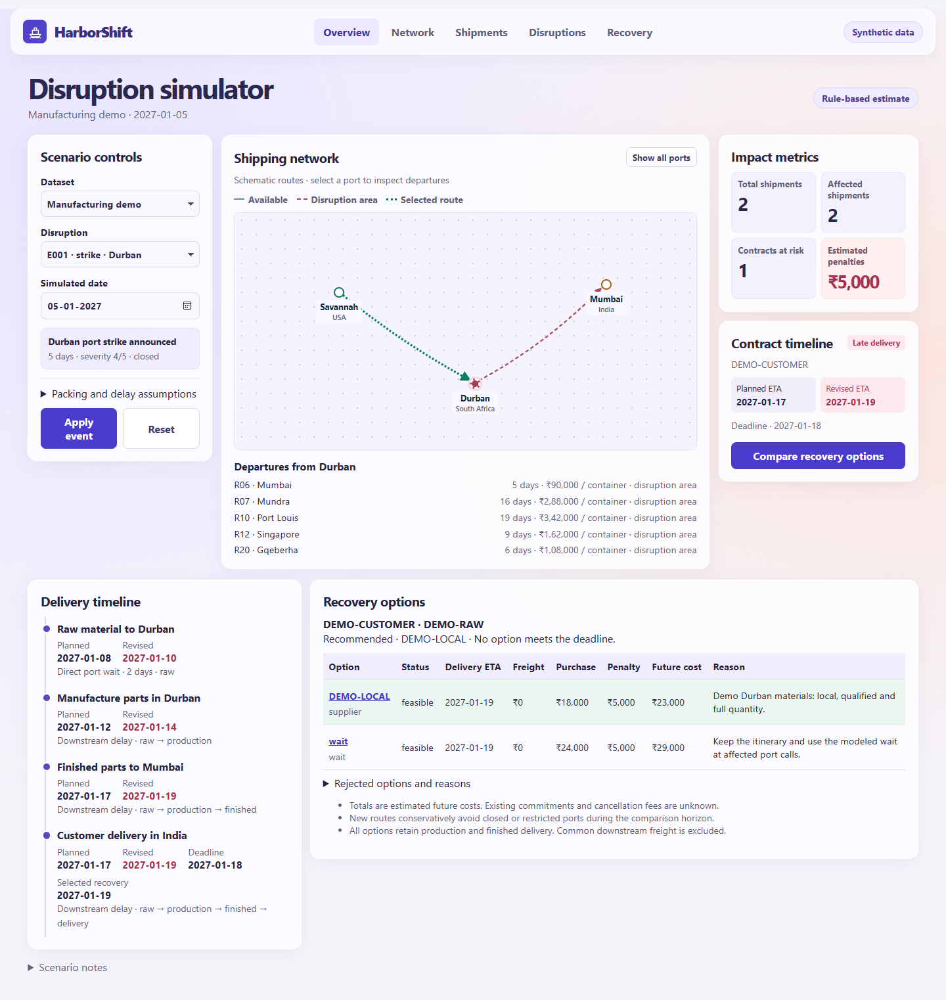
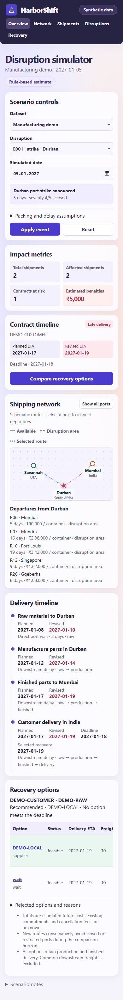

# HarborShift demonstration

## Four-minute walkthrough

1. **0:00–0:45 · Baseline.** Start the API and dashboard using the README. In Overview, keep **Manufacturing demo** selected. Show the customer delivery planned for January 17, with a January 18 deadline. Select Durban on the network to show its outgoing services.
2. **0:45–1:30 · Disruption.** Apply the default E001 Durban strike. The two-day wait on DEMO-RAW moves factory work from January 8 to January 10. Follow the dependency path to customer delivery, now January 19. Point out the one-day lateness and INR 5,000 estimated penalty.
3. **1:30–2:15 · Recovery.** Compare waiting and DEMO-LOCAL, the synthetic qualified Durban supplier. Select a row to show its modeled ETA and route. Explain why both arrivals miss the deadline in E001. Try a manual Savannah strike from January 1 for four days to show local raw sourcing restoring the planned January 17 delivery while keeping production in Durban.
4. **2:15–3:10 · Algorithms.** The transport graph stores directed adjacency lists, and Dijkstra uses a heap plus predecessor edges. Shipment impacts use port-call indexes. The task DAG uses BFS for dependency paths and Kahn's topological sort for scheduling. A separate heap ranks deadline risk.
5. **3:10–4:00 · Delay model and reset.** Choose **Sample shipments**, SH044, and E004. Apply the event with the rule estimate, then turn on synthetic ML in the assumptions and apply it again. Compare the reported delay source. Reset and show that the original schedule returns. The entire demonstration works without fetching advisories.

## Algorithm complexity

| Component | Complexity |
|---|---|
| Transport adjacency lists | O(V + E) construction and storage. Average O(1) ID lookups. |
| Dijkstra with a lazy heap | O(V + E log(E + 1)) time and O(V + E) working storage per consecutive pair of required stops. |
| Port and route indexes | O(L) storage for L legs. Building sorted itineraries also sorts legs within each shipment. |
| Kahn ordering and a schedule pass | O(T + D) for T tasks and D dependency links, excluding per-task port impact calculation. |
| BFS cause paths | O(T + D) traversal per direct-delay root, plus the size of copied explanation paths. |
| Urgency heap | O(A log(A + 1)) for A affected entries. |
| Recovery ranking | O(K log(K + 1)) for K candidates after evaluating supplier and route feasibility. |

## Verification cases

A clean Windows copy passed 67 Python tests and four Chromium browser tests using Edge. The frontend production build and model retraining succeeded. The browser scenario blocked non-local requests, and the workflow still passed. Joblib reports a deprecation warning when loading arrays with NumPy 2.5.

The regression suite covers the entire manufacturing chain and reset, route recovery, local supplier recovery, feasibility filters, simultaneous events, impossible routes, optional model fallback, and public feed failure. The browser suite exercises the real API on desktop and mobile, including scenario apply/reset, selecting recovery, and no-route output.

### Desktop

### Mobile

